<picture><source media="(prefers-color-scheme: dark)" srcset="assets/hero-dark.svg"></picture>

<picture><source media="(prefers-color-scheme: dark)" srcset="assets/social-l-dark.svg"></picture><a href="https://t.me/RubCut"><picture><source media="(prefers-color-scheme: dark)" srcset="assets/social-1-dark.svg"></picture></a><a href="https://www.tiktok.com/@burmaldakotost?"><picture><source media="(prefers-color-scheme: dark)" srcset="assets/social-2-dark.svg"></picture></a><picture><source media="(prefers-color-scheme: dark)" srcset="assets/social-r-dark.svg"></picture>

<picture><source media="(prefers-color-scheme: dark)" srcset="assets/about-dark.svg"></picture>

<picture><source media="(prefers-color-scheme: dark)" srcset="assets/stack-dark.svg"></picture>

<a href="https://github.com/RubCut/Paint.QT"><picture><source media="(prefers-color-scheme: dark)" srcset="assets/project-paint-qt-dark.svg"></picture></a>&nbsp;<a href="https://github.com/RubCut/2GIS-Smartspacer-Plugin"><picture><source media="(prefers-color-scheme: dark)" srcset="assets/project-2gis-smartspacer-plugin-dark.svg"></picture></a>

<a href="https://github.com/RubCut/AI-news-Smartspacer-plugin"><picture><source media="(prefers-color-scheme: dark)" srcset="assets/project-ai-news-smartspacer-plugin-dark.svg"></picture></a>&nbsp;<a href="https://github.com/RubCut/RubPatches"><picture><source media="(prefers-color-scheme: dark)" srcset="assets/project-rubpatches-dark.svg"></picture></a>

<picture><source media="(prefers-color-scheme: dark)" srcset="assets/stats-dark.svg"></picture>

<picture><source media="(prefers-color-scheme: dark)" srcset="assets/wave-dark.svg"></picture>

